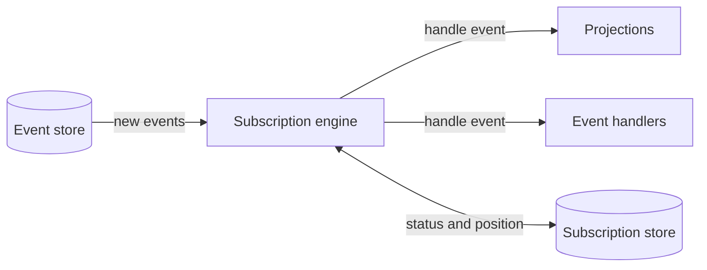

# Subscription Engine

[](https://packagist.org/packages/wwwision/subscription-engine)
[](./composer.json)
[](./LICENSE)

**Keep the projections and event handlers of your event-sourced PHP application up to date.**

The engine passes new events from your event store to your subscribers and remembers how far each of them got. That makes it possible to add a subscriber at any time, rebuild a projection from the first event, and fix a failing subscriber without affecting the others.



- **Works with your stack:** Adapters for different event stores and databases, or write your own
- **Rebuild at any time:** Replay all events into a projection after fixing a bug or changing its schema
- **Isolated failures:** A failing subscriber stops, while the others continue
- **Exactly once:** A projection that uses the connection of the subscription store is saved together with its progress
- **Ready to scale:** Process large backlogs in batches and run workers in parallel (2.0)

> [!NOTE]
> This documentation describes the upcoming version 2.0. Features that aren't part of the latest release are marked with **(2.0)**, see [how to try them](#try-the-upcoming-version).

## Quick start

This example uses a SQLite database and needs PHP 8.3+ with `pdo_sqlite`. Install the engine, a subscription store, an event store and the matching adapter:

```bash
composer require wwwision/subscription-engine wwwision/subscription-engine-doctrine wwwision/subscription-engine-dcb-adapter wwwision/dcb-eventstore-doctrine
```

Save this as `quickstart.php`:

```php
<?php

declare(strict_types=1);

use Doctrine\DBAL\DriverManager;
use Doctrine\DBAL\Tools\DsnParser;
use Wwwision\DCBEventStore\Event\Event;
use Wwwision\DCBEventStore\Event\Events;
use Wwwision\DCBEventStore\SequencedEvent\SequencedEvent;
use Wwwision\DCBEventStoreDoctrine\DoctrineEventStore;
use Wwwision\SubscriptionEngine\Subscriber\Subscriber;
use Wwwision\SubscriptionEngine\Subscriber\Subscribers;
use Wwwision\SubscriptionEngine\SubscriptionEngine;
use Wwwision\SubscriptionEngineDcbAdapter\DcbEventStoreAdapter;
use Wwwision\SubscriptionEngineDoctrine\DoctrineSubscriptionStore;

require __DIR__ . '/vendor/autoload.php';

$connection = DriverManager::getConnection((new DsnParser())->parse('pdo-sqlite:///' . __DIR__ . '/demo.sqlite'));
$eventStore = DoctrineEventStore::create($connection, eventTableName: 'events');

$engine = new SubscriptionEngine(
    eventStoreAdapter: new DcbEventStoreAdapter($eventStore),
    subscriptionStore: new DoctrineSubscriptionStore($connection, tableName: 'subscriptions'),
    subscribers: Subscribers::fromArray([
        Subscriber::create(
            id: 'activity-log',
            handler: fn (SequencedEvent $event) => $connection->insert('activity_log', [
                'position' => $event->position->value,
                'type' => $event->event->type->value,
            ]),
            setup: fn () => $connection->executeStatement('CREATE TABLE IF NOT EXISTS activity_log (position INTEGER PRIMARY KEY, type TEXT NOT NULL)'),
            reset: fn () => $connection->executeStatement('DELETE FROM activity_log'),
        ),
    ]),
);

// 1. Once per deployment: Create the tables, register the subscribers and process past events
$eventStore->setup();
$engine->setup();
$engine->boot();

// 2. Store some events
$eventStore->append(Events::fromArray([
    Event::create('ProductAdded', '{"id": "p1"}'),
    Event::create('ProductRenamed', '{"id": "p1", "name": "New name"}'),
]));

// 3. Pass the new events to the subscribers
$engine->catchUpActive();

foreach ($connection->fetchAllAssociative('SELECT * FROM activity_log') as $row) {
    echo "{$row['position']}: {$row['type']}\n";
}
```

Then run it:

```console
$ php quickstart.php
1: ProductAdded
2: ProductRenamed
```

## Which packages do I need?

The engine itself contains no database code. Choose one event store adapter and one subscription store:

| You need | Package | For |
|---|---|---|
| **An event store adapter** | [wwwision/subscription-engine-dcb-adapter](https://github.com/bwaidelich/subscription-engine-dcb-adapter) | [wwwision/dcb-eventstore](https://github.com/bwaidelich/dcb-eventstore) |
| | [wwwision/subscription-engine-neos-adapter](https://github.com/bwaidelich/subscription-engine-neos-adapter) | [neos/eventstore](https://github.com/neos/eventstore) |
| **A subscription store** | [wwwision/subscription-engine-doctrine](https://github.com/bwaidelich/subscription-engine-doctrine) | MySQL, MariaDB, PostgreSQL and SQLite with Doctrine DBAL |
| | [ekvedaras/subscription-engine-illuminate](https://packagist.org/packages/ekvedaras/subscription-engine-illuminate) | [Laravel database](https://laravel.com/docs/12.x/database) |
| **Background processing** (optional) | [wwwision/subscription-engine-worker](https://github.com/bwaidelich/subscription-engine-worker) (2.0) | A long-running process with Supervisor and Kubernetes examples |

Nothing suitable? See [Writing your own store or adapter](./docs/how-it-works.md#writing-your-own-store-or-adapter).

## Guides

The handlers in these guides receive a `SequencedEvent`, as in the quick start. The event type depends on [your adapter](#which-packages-do-i-need).

- [Add a projection](#add-a-projection)
- [React to new events only](#react-to-new-events-only)
- [Deploy](#deploy)
- [Process new events](#process-new-events)
- [Rebuild a projection](#rebuild-a-projection)
- [Handle failures](#handle-failures)
- [See what is going on](#see-what-is-going-on)
- [Process a large backlog in batches](#process-a-large-backlog-in-batches-20) (2.0)
- [Run several workers in parallel](#run-several-workers-in-parallel-20) (2.0)

### Add a projection

A projection builds a table, or anything else you can query, from all events. Only `id` and `handler` are required:

```php
Subscriber::create(
    id: 'product-list',
    handler: function (SequencedEvent $event) use ($connection): void {
        // update the table for this event
    },
    setup: fn () => $connection->executeStatement('CREATE TABLE IF NOT EXISTS product_list (...)'),
    reset: fn () => $connection->executeStatement('DELETE FROM product_list'),
);
```

- `setup` prepares what the subscriber needs. It runs with every `$engine->setup()` call, so it has to be repeatable
- `reset` removes the data, so that the projection can be rebuilt

> [!IMPORTANT]
> Use the same database connection as the subscription store for everything a projection writes. Its changes are then saved together with the progress of the subscription, so that each event counts exactly once. With anything else, an event can be handled more than once.

### React to new events only

Some handlers must not run for events from the past, for example one that sends an email. Set their run mode to `FROM_NOW`, so that they start with the next new event:

```php
use Wwwision\SubscriptionEngine\Subscription\RunMode;

Subscriber::create(
    id: 'order-confirmation',
    handler: fn (SequencedEvent $event) => $mailer->sendOrderConfirmation($event),
    runMode: RunMode::FROM_NOW,
);
```

### Deploy

Run this once per deployment, not in every process:

```php
$engine->setup(); // creates the tables and registers new subscribers
$engine->boot();  // passes past events to the subscribers that are new or were reset
```

Existing subscribers aren't affected. A new `FROM_BEGINNING` subscriber, the default, receives all past events during `boot()`. After that, it counts as active and receives new events.

### Process new events

To update your projections directly after storing an event, call `catchUpActive()` in the same process. When it returns, the events have been handled:

```php
$eventStore->append($events);
$engine->catchUpActive();
```

To keep requests fast, leave this to a process that runs in the background instead, for example [wwwision/subscription-engine-worker](https://github.com/bwaidelich/subscription-engine-worker) (2.0).

### Rebuild a projection

For example after fixing a bug or changing the structure of a table. This calls the `reset` function of the subscriber and starts over with the first event:

```php
use Wwwision\SubscriptionEngine\Engine\SubscriptionEngineCriteria;

$criteria = SubscriptionEngineCriteria::create(['product-list']);
$engine->reset($criteria);
$engine->boot($criteria);
```

> [!WARNING]
> `reset()` affects **all** subscribers if you don't pass any criteria, and `boot()` passes all past events to them, including the `FROM_NOW` ones: A subscriber that sends emails would send them again. To skip the past events after resetting a `FROM_NOW` subscriber, call `$engine->setup($criteria)` instead of `boot()`.

If you run a worker, or anything else that keeps processing, stop it first when using version 1.x. As of version 2.0 it can [keep running](./docs/how-it-works.md#reset-and-setup-with-running-workers).

### Handle failures

If a handler throws an exception, its subscription stops with the status `ERROR`, and the other subscribers continue. The engine doesn't throw in this case, so check the result:

```php
$result = $engine->catchUpActive();

if (!$result->successful()) {
    foreach ($result->errors as $error) {
        printf("%s failed at event %d: %s\n", $error->subscriptionId->value, $error->position?->value, $error->message);
    }
}
```

The handler may have applied the event partially, so the engine doesn't retry it. Fix the cause and [rebuild the projection](#rebuild-a-projection).

Database errors, such as a deadlock, can behave differently and are repeated automatically. See [Exceptions during a catch-up](./docs/how-it-works.md#exceptions-during-a-catch-up).

### See what is going on

Get the current state of all subscriptions, for example for a status command:

```php
foreach ($engine->getSubscriptions() as $subscription) {
    printf("%s: %s at position %d\n", $subscription->id->value, $subscription->status->value, $subscription->position->value);
}
```

```console
product-list: ACTIVE at position 42
order-confirmation: ERROR at position 17
```

The engine also reports what it does through engine events. Their log level allows you to filter them:

```php
use Wwwision\SubscriptionEngine\Engine\EngineEvent\EngineEvent;

$engine->onEngineEvent(function (EngineEvent $event): void {
    if ($event->logLevel() <= LOG_WARNING) {
        error_log((string) $event);
    }
});
```

### Process a large backlog in batches (2.0)

By default, a catch-up reads to the end of the event log in a single transaction. With `limit`, it stops after that number of events and saves its progress, so that the transactions stay small:

```php
do {
    $result = $engine->catchUpActive(limit: 500);
    if (!$result->successful()) {
        // handle $result->errors
    }
} while ($result->hasPendingEvents);
```

`boot()` supports `limit` as well. [Details](./docs/how-it-works.md#bounded-catch-ups)

### Run several workers in parallel (2.0)

[wwwision/subscription-engine-worker](https://github.com/bwaidelich/subscription-engine-worker) does this for you: Start the same script as often as you like. It also takes care of stop signals, retries and restarts.

To write your own loop, use `catchUpNextActive()` and `bootNext()`. Each call picks one subscription that no other worker is busy with:

```php
while (true) {
    $result = $engine->catchUpNextActive(limit: 500);
    if (!$result->successful()) {
        // handle $result->errors: The next call claims the failed subscription again,
        // leave it out through SubscriptionEngineCriteria for a while so that the others can continue
    }
    if (!$result->hasPendingEvents) {
        usleep(100_000); // nothing to do, or everything is locked by other workers
    }
}
```

> [!WARNING]
> Leave failed subscriptions out, and don't assume any order between subscribers: One can be ahead of another. [Details](./docs/how-it-works.md#concurrent-workers)

## Cheat sheet

### Methods

All methods accept an optional `SubscriptionEngineCriteria` to restrict them to certain subscribers.

| Method | What it does |
|---|---|
| `setup()` | Creates the subscription table, registers new subscribers and calls their `setup` function |
| `boot()` | Passes past events to subscribers in the status `BOOTING` and activates them |
| `catchUpActive()` | Passes new events to subscribers in the status `ACTIVE` |
| `reset()` | Calls the `reset` function and moves subscribers back to the first event, in the status `BOOTING` |
| `getSubscriptions()` | Returns the state of the subscriptions. `getSubscription($id)` returns a single one |
| `bootNext()`, `catchUpNextActive()` | Like `boot()` and `catchUpActive()`, for a single free subscription (2.0) |

### Statuses

| Status | Meaning | What to do |
|---|---|---|
| `NEW` | Discovered, but not set up | Call `setup()` |
| `BOOTING` | Set up or reset, past events are pending | Call `boot()` |
| `ACTIVE` | Receives new events | Nothing |
| `ERROR` | A subscriber failed | Fix the cause, then call `reset()` and `boot()` |
| `RESETTING` (2.0) | The `reset` function is running, or has crashed | Wait. [If it has crashed](./docs/how-it-works.md#reset-and-setup-with-running-workers), call `reset($criteria, force: true)` |
| `DETACHED` | The subscriber doesn't exist anymore | Nothing if you removed it. Otherwise call `reset()` and `boot()` |

## Try the upcoming version

Version 2.0 isn't released yet, and its APIs can still change. To try it, allow development versions in your `composer.json`:

```bash
composer config minimum-stability dev
composer config prefer-stable true
composer require wwwision/subscription-engine:2.x-dev wwwision/subscription-engine-doctrine:dev-main wwwision/subscription-engine-dcb-adapter:dev-main
```

With `neos/eventstore`, use `wwwision/subscription-engine-neos-adapter:dev-main` instead of the DCB adapter. Coming from 1.x? See the [upgrade guide](./docs/upgrading.md).

## Learn more

- [How it works](./docs/how-it-works.md): Statuses, guarantees, concurrency, failures and how to write your own store or adapter
- [Upgrading to 2.0](./docs/upgrading.md): Required changes, and known problems of 1.x
- [Decisions](./docs/decisions.md): The reasoning behind the design

## Contribution

Contributions in the form of [issues](https://github.com/bwaidelich/subscription-engine/issues) or [pull requests](https://github.com/bwaidelich/subscription-engine/pulls) are highly appreciated. Run the checks with `composer test`.

## License

See [LICENSE](./LICENSE)

## Acknowledgements

This implementation is heavily inspired by parts of the [patchlevel/event-sourcing](https://packagist.org/packages/patchlevel/event-sourcing) package
