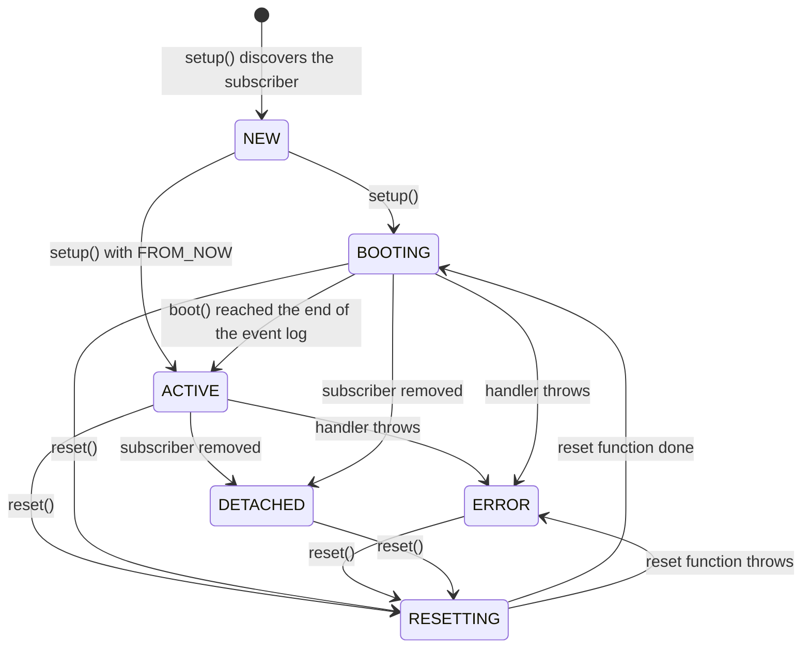

# How it works

The technical details behind the [README](../README.md). You don't need them to get started. For the reasoning behind these choices, see [decisions.md](./decisions.md).

- [Terms](#terms)
- [The life of a subscription](#the-life-of-a-subscription)
- [What is guaranteed](#what-is-guaranteed)
- [Bounded catch-ups](#bounded-catch-ups)
- [Concurrent workers](#concurrent-workers)
- [Filtered subscribers](#filtered-subscribers)
- [`reset()` and `setup()` with running workers](#reset-and-setup-with-running-workers)
- [Exceptions during a catch-up](#exceptions-during-a-catch-up)
- [Writing your own store or adapter](#writing-your-own-store-or-adapter)

## Terms

| Term | Meaning |
|---|---|
| **Subscriber** | Your code that reacts to events: A `handler`, and optionally `setup` and `reset` functions |
| **Subscription** | The persisted state of a subscriber: Its status, run mode, position and last error |
| **Position** | The last event a subscription has handled, as position in the global event log |
| **Catch-up** | One run that passes events to subscribers. It reads from the lowest position of its subscriptions |
| **Run mode** | `FROM_BEGINNING` receives all events, `FROM_NOW` starts at the end of the event log during `setup()` |

## The life of a subscription



- `NEW` subscriptions wait for `setup()`, and `ERROR`, `DETACHED` and `RESETTING` are ignored by catch-ups
- A failing `setup` function moves the subscription to `ERROR` as well
- `reset()` always moves a subscription to the first event. This also applies to `FROM_NOW`: `boot()` passes all past events to it, while another `setup()` moves it to the end of the event log

## What is guaranteed

**Exactly once** only applies to handlers that write through the connection of the subscription store: Their changes are part of the transaction of the catch-up. Handlers that write anywhere else get **at-least-once**, because a batch is repeated if a process is killed or a run fails.

Events of a subscription are always handled in order.

## Bounded catch-ups

By default, `SubscriptionEngine::catchUpActive()` and `SubscriptionEngine::boot()` read to the end of the event log in a single transaction and hold the lock on all matching subscriptions until they are done.
With the `limit` parameter a call reads at most that number of events, persists the positions, commits and returns. The lock is released between two calls, so other workers can take their turn.

- `hasPendingEvents` means that calling the method again with the same arguments could process more events. It is `false` if all subscriptions of the run failed, even if the event log contains more events
- A subscription that is booted partially stays `BOOTING` until no events are pending
- `limit` counts the events that are read, including events that are skipped by subscriptions that are already ahead. The number of handler invocations can be higher: With 10 subscriptions, `limit: 500` can lead to 5,000 invocations
- A run reads from the lowest position of its subscriptions, so subscriptions that are ahead receive no new events until the one lagging behind has caught up. To prevent that, catch up independently lagging subscriptions separately via `SubscriptionEngineCriteria`

See [decisions.md](./decisions.md#bounded-catch-ups-target-20) for the reasoning.

## Concurrent workers

`SubscriptionEngine::catchUpNextActive()` and `SubscriptionEngine::bootNext()` allow several workers to process the same set of subscriptions in parallel, without advisory locks or partition assignment.
Each call claims one subscription, the one with the lowest position that is not locked by another worker, and catches it up in its own transaction. `$result->allSubscriptionsLocked` tells whether everything was locked by other workers.

- `catchUpActive()` and `boot()` keep waiting for locks and remain the choice if the caller relies on its events being processed once the call returns. Both kinds of workers can be mixed
- `hasPendingEvents` means that calling the method again with the same arguments could process more events, for any matching subscription. Keep polling instead of exiting: In rare cases it is `false` while a subscription lags, and a worker holding a lock could get killed
- A booting subscription is activated as soon as it has reached the end of the event log, independent of the others
- Events of one subscription are always handled in order. There is no order *between* subscribers though: One can be ahead of another, so a handler must not rely on the projection of a different subscriber
- N subscriptions take N reads of the event log, instead of one that they share

### Failing runs

If a run fails after the claim, for example because of a deadlock or a repeating SQL error on PostgreSQL, it is rolled back and the method returns a failed result instead of throwing, unlike `catchUpActive()` and `boot()`. The subscription keeps its status, and the id is part of `$result->errors`.

The engine keeps no memory of failed runs. As the lowest position is claimed first, the next call claims the failing subscription again. Retrying it is up to the caller:

- Leave it out through `SubscriptionEngineCriteria` for a while, for example with an exponential backoff, so that the others can continue
- It still counts for `hasPendingEvents`, because it is still behind. A loop on `while ($result->hasPendingEvents)` that doesn't leave it out never ends
- It never goes to `ERROR` by itself. A repeating failure is only visible through `successful()` and the `SubscriberFailedToHandleEvent` and `CatchUpRunFailed` engine events, and the subscription falls behind

> [!WARNING]
> A process that makes a single call and exits runs into a failing subscription every time and starves the others. Use `catchUpActive()` and `boot()` for single calls, and `catchUpNextActive()` and `bootNext()` in loops that leave failed subscriptions out.

See [decisions.md](./decisions.md#skip-locked-catch-ups-target-20) for the reasoning.

## Filtered subscribers

A subscriber can declare a filter, so that it only receives matching events. Its type depends on the adapter, for example a `Query` for the DCB adapter:

```php
Subscriber::create(
    id: 'orders',
    handler: $handler,
    filter: Query::fromItems(QueryItem::create(eventTypes: 'OrderPlaced')),
);
```

- If a run contains only this subscription, for example with `catchUpNextActive()` and `bootNext()`, the adapter applies the filter and only matching events are read. The run reads up to the position of the last event at its start, and the subscription moves there even if none of the events matched
- A run with several subscriptions reads all events once and passes each one only to the subscribers whose filter matches it. The positions of the others advance as well
- `limit` counts the events that are read, so with one filtered subscription it counts matching events
- The filter is not persisted. Changing it does not pass the events that the old filter excluded, use a new subscriber id or `reset()` for that

See [decisions.md](./decisions.md#filtered-reads-target-20) for the reasoning.

## `reset()` and `setup()` with running workers

Workers don't have to be stopped. `reset()` waits for running catch-ups and sets the status `RESETTING`, which no catch-up matches, for all matching subscriptions. The reset functions then run without a lock, so they can use DDL like `TRUNCATE`, and each subscription goes to `BOOTING` at position 0 afterwards.

- If a reset function fails, the subscription goes to `ERROR` and no worker continues on the partially cleared projection. Call `reset()` again to retry
- If a subscription is already `RESETTING`, another reset is running or has crashed. `reset()` skips it and reports an error. Once you know that the other process is gone, take over with `reset($criteria, force: true)`. This runs the reset function again
- `reset()` throws if it can't get the locks in time or runs into a deadlock with a blocking worker, which is possible on MySQL and MariaDB. Nothing has changed in that case and the call can be repeated

`setup()` does not stop workers: Its functions run while events are being handled, so they have to stay compatible with the running code. Stop the workers for a setup that needs exclusive access.

See [decisions.md](./decisions.md#the-reset-race-target-20) for the reasoning.

## Exceptions during a catch-up

An exception that escapes a catch-up, for example a deadlock, rolls back the current run and is rethrown.
Positions and everything else that is part of the transaction stay at the last committed batch, so the catch-up can be repeated with the same engine instance.

> [!NOTE]
> A database error inside a subscriber is usually not an escaping exception: The subscription goes to `ERROR` and the run continues without it.
> If the error has ended the transaction, which MySQL and MariaDB do for a deadlock victim and PostgreSQL for every SQL error, the store fails on its next write. That exception escapes, so no subscription goes to `ERROR` and the batch is repeated on the next catch-up. An error that keeps occurring on PostgreSQL therefore blocks all subscriptions of the run. Run them separately via `SubscriptionEngineCriteria` to isolate it.

See [decisions.md](./decisions.md#escaping-exceptions-roll-back-the-run-target-20) for the reasoning.

## Writing your own store or adapter

The engine needs an implementation of two interfaces. The [doctrine store](https://github.com/bwaidelich/subscription-engine-doctrine) and the [DCB adapter](https://github.com/bwaidelich/subscription-engine-dcb-adapter) are small examples.

### `EventStoreAdapter`

The [`EventStoreAdapter`](../src/EventStore/EventStoreAdapter.php) connects the engine to an event store. It reads events in the order of their position, determines the position of an event, and returns the position of the last one.
It defines which filters subscribers can declare: `read()` has to apply them, and `matches()` has to decide the same way for a single event.

### `SubscriptionStore`

The [`SubscriptionStore`](../src/Store/SubscriptionStore.php) persists the state of subscriptions, and allows to lock them such that multiple processes cannot change the same subscription at the same time. The interface documents what each method has to guarantee.

Stores on MySQL and MariaDB: With the default isolation level (`REPEATABLE READ`), workers that wait for a subscription lock can deadlock with a worker that changes the status of a subscription. `SubscriptionStore` implementations should use `READ COMMITTED` for their transactions on these databases, as [wwwision/subscription-engine-doctrine](https://github.com/bwaidelich/subscription-engine-doctrine) does.
